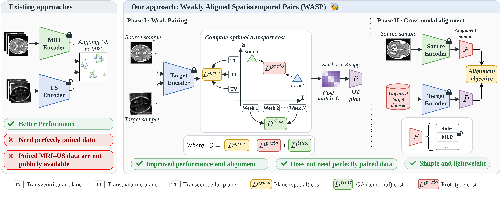

# WASP: Weakly Aligned Spatiotemporal Pairs

Code for *WASP: Weakly Aligned Spatiotemporal Pairs for Fetal Brain MRI–Ultrasound Learning*.



No public dataset pairs fetal MRI and ultrasound from the same subject. WASP builds soft cross-modal pairs from metadata that is recorded routinely, gestational age (GA) and standard diagnostic plane (TV, TT, TC), using entropic optimal transport. It then fits a lightweight alignment (Ridge, MLP, CCA) on frozen backbone features. With this alignment, an ultrasound-only foundation model can read fetal MRI without fine-tuning.

## Installation

```bash
pip install -e .
```

## Data

The metadata of the 4,056 brain images, with their splits, and their average-pooled patch embeddings from four frozen backbones will be released soon; download them into `data/`.

```
data/
├── metadata.csv          id, modality, split, subject_id, dataset, ga_days, plane
└── embeddings/
    ├── usfm.npz          id (N,), X (N, 768)
    ├── echocare.npz      id (N,), X (N, 2048)
    ├── sam_med2d.npz     id (N,), X (N, 768)
    └── biomedparse.npz   id (N,), X (N, 1536)
```

`split` is `pair` (used only to fit `F`), `train` (probe fitting and cross-validation) or `test`. Splits are subject-disjoint. The GA of ultrasound images is estimated from biometry with the Hadlock formulas.

## Preprocessing

[`preprocess/`](preprocess) goes from the original images to the embeddings: ultrasound head masking and alignment, MRI registration and plane extraction, and feature extraction with the four backbones. See [`preprocess/README.md`](preprocess/README.md).

## Usage

```bash
python -m wasp table --backbone usfm                      # pairings x alignments, MRI -> US
python -m wasp table --backbone usfm --source US          # same, US -> MRI
python -m wasp ablate --backbone usfm --alignment ridge   # cost-term ablation
python -m wasp sensitivity --backbone usfm                # MLP hyperparameter sensitivity
python -m wasp distill --student usfm --teacher sam_med2d # teacher-student distillation
```

`table` fits every pairing (Greedy, Hungarian, WASP, Random, Cosine) with every alignment (CCA, Ridge, MLP), plus CORAL. It selects hyperparameters by subject-level cross-validation on the training split and reports GA MAE and plane accuracy on the test split. The full grid is saved in `results/`. `ablate` reruns WASP with every subset of the three cost terms. `sensitivity` shows WASP + MLP across the OT regularization and the GA bin width. `distill` aligns a student backbone to the WASP-aligned space of a teacher. These three commands reuse the grid of `table`, so run it first.

Every command also takes `--source` (`MRI` or `US`, the modality to align), `--data` (default `data`), `--out` (default `results`), `--folds` and `--seed`. `table` takes `--pairings` and `--alignments` to run a subset of the grid.

## Your own data

WASP needs only embeddings, GA and plane. Put a `metadata.csv` with the columns above in a folder, with one `embeddings/<name>.npz` per backbone. Each `.npz` holds the image `id`s and their embeddings `X`. Every row needs a `split`: `pair` images are used only to build the pairs and fit the alignment, while `train` and `test` evaluate it. Then run:

```bash
python -m wasp table --data <dir> --backbone <name>
```

`--source` selects the modality to align (`MRI` or `US`). `examples/toy_data.py` writes a synthetic dataset in this format:

```bash
python examples/toy_data.py --out data/toy
python -m wasp table --data data/toy --backbone toy
```

## License

Code: [MIT](LICENSE). The metadata and embeddings are derived from third-party datasets and are subject to their terms.
