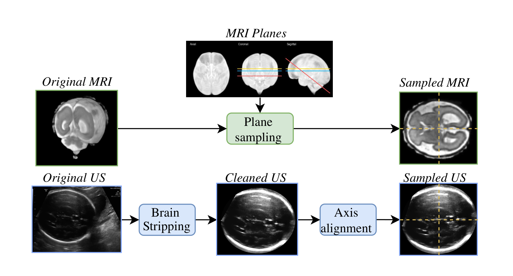

# Preprocessing

These scripts go from the original images to the embeddings in `data/embeddings/`.



## Setup

```bash
pip install -e ".[preprocess]"
```

Put the original images and SRR volumes in `raw/<dataset>/<file>`, as listed in [`us_ellipses.csv`](us_ellipses.csv) and [`mri_volumes.csv`](mri_volumes.csv). The MRI step also needs the [CRL fetal brain atlas](http://crl.med.harvard.edu/research/fetal_brain_atlas/) (`STA21.nii.gz` ... `STA38exp.nii.gz`).

## Ultrasound

```bash
python preprocess/us.py --images preprocess/us_ellipses.csv --out work/us --root raw
```

Each image comes with an ellipse around the fetal head (`cx`, `cy`, `semi_major`, `semi_minor`, `angle_deg`). The ellipse is taken from the OFD/BPD landmarks of [Di Vece et al.](https://arxiv.org/abs/2512.16710) or, when they are missing, fitted to a head segmentation. The image is masked with the ellipse and rotated so that the occipitofrontal axis is horizontal. For new images, give the landmark columns (`ofd_1_x`, ..., `bpd_2_y`) instead of the ellipse.

## MRI

```bash
python preprocess/mri.py --volumes preprocess/mri_volumes.csv --atlas <crl_atlas> --out work/mri --root raw --add-atlas
```

Each volume is rigidly registered, by mutual information, to the CRL template of its gestational week. The TV, TT and TC planes are defined once per week in template space ([`planes.csv`](planes.csv), LPS millimetres) and sampled at 0.8 mm. `--add-atlas` also slices the templates themselves.

## Embeddings

```bash
python preprocess/extract.py --backbone usfm --checkpoint <USFM.pth> --images work/us work/mri --out data/embeddings
```

Each image is cropped to its foreground, resized so that its longer side is 224 pixels, zero-padded and min-max normalized (then resized to 256 for SAM-Med2D and EchoCare). The embedding is the mean of the last-layer patch tokens. `--backbone` is `usfm`, `echocare`, `sam_med2d` or `biomedparse`, with the official checkpoint of that model. The output is `<backbone>.npz` with the image `id`s and their embeddings `X`.
